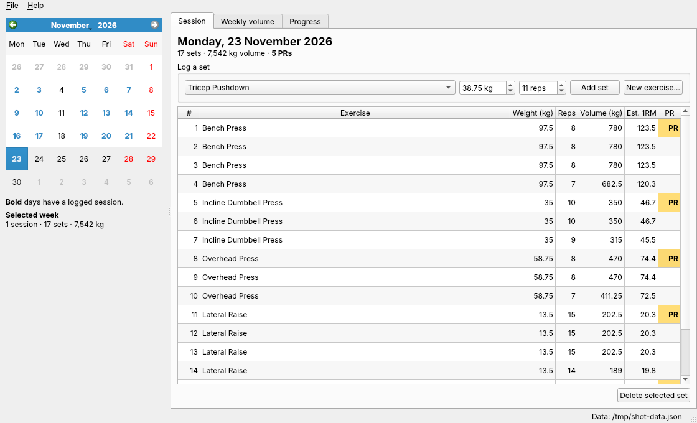
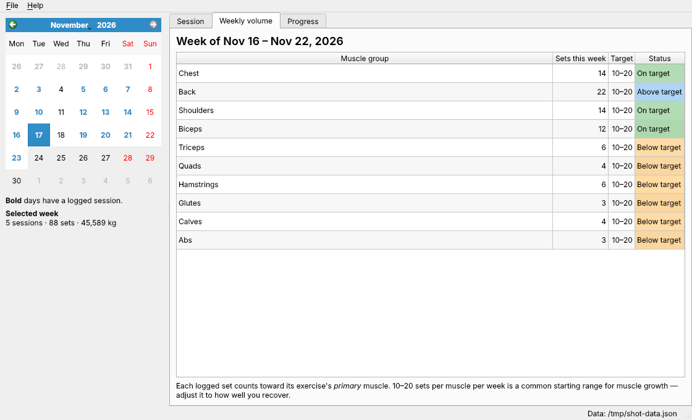
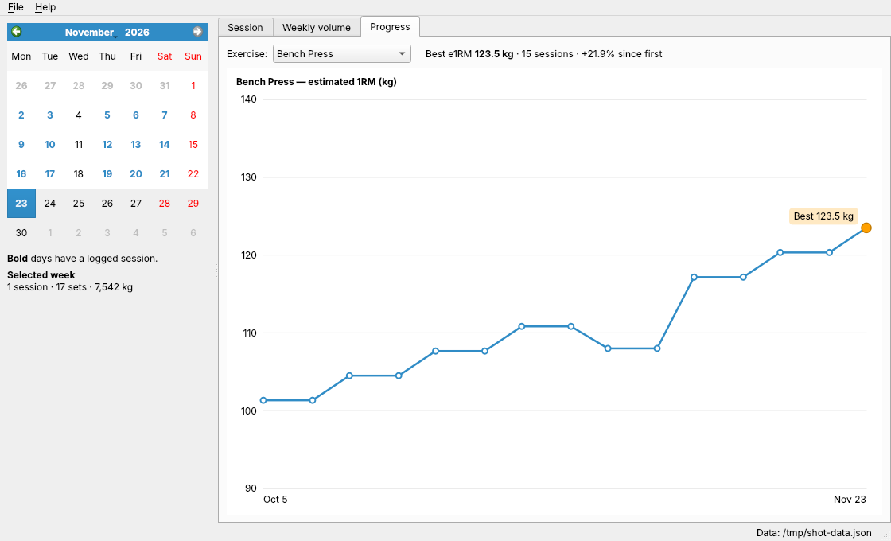

# IronLog

[](https://github.com/LovedArie/IronLog/actions/workflows/ci.yml)

IronLog is becoming a **phone-first training coach** (see *Where it's going*).
Today, **v0.1.0 is a desktop training log** in C++17 and Qt 6:

- Log your sets.
- See personal records (PRs) the moment you hit them.
- Check weekly sets per muscle group.
- Watch your **e1RM** climb on a chart. *(e1RM = estimated one-rep max: the most you could lift once.)*

> **Start here:** [Vision](docs/01_Vision.md) (what and why) →
> [BACKLOG](docs/BACKLOG.md) (what's next) → [DEVELOPING](docs/DEVELOPING.md) (how we work).



---

## Where it's going

v0.1 is a desktop logbook. The goal ([Vision](docs/01_Vision.md),
[Backlog](docs/BACKLOG.md)) is a **phone-first training coach**:

- **Train now** builds today's workout from your time, place and equipment.
- **Game (optional):** 8 skills level up as you train, like skills in an MMO
  (online role-playing game). They fade slowly if you stop. A **Pause**
  protects exam weeks.
- **Weekly quest:** finish it to earn a rest token and your own reward.
- **Pictures:** each exercise has a how-to picture, a muscle diagram and a short clip.
- **Sync:** your data lives on your own server.

| Milestone | Theme |
|---|---|
| v0.2 | Foundation: test build of the phone UI (QML spike), data format v2, exercise catalog v2, edit + undo, backups. *(CI/CD — automatic build, test and release — is already done.)* |
| v0.3 | Coach: profiles, goal programs, *Train now*, guided sessions, exercise pictures |
| v0.4 | Game & body: skills, XP (experience points), slow decay, pauses, quests, streak, body check-ins, photos |
| v0.5 | Online: server on the owner's rented server (VPS), accounts, sync |
| v0.6 | Progress+: more PR types, plate/warm-up calculator, stall → deload hint, retire the desktop (Widgets) UI |

## Features

| Feature | What you see |
|---|---|
| **Log sets** | Pick a day on the calendar, choose an exercise, enter kg × reps. Weight and reps pre-fill from last time. |
| **Personal records** | A gold **PR** badge on any set that beats your previous best estimated 1RM. |
| **Weekly volume** | Sets per muscle group for the Monday–Sunday week, marked *below / on / above* a 10–20 set target. |
| **Progress chart** | Estimated 1RM per session for any exercise, best point highlighted. |
| **Custom exercises** | Add your own, each tied to a primary muscle group. |
| **Safe saving** | Auto-saves after every change with an atomic write. A corrupt file is moved aside, never overwritten. |
| **Sample data** | *File → Load sample data* fills an empty log with 8 weeks of push/pull/legs training. |

| Weekly volume | Progress |
|---|---|
|  |  |

---

## Build and run

### Qt Creator (Windows — the usual way)

1. *File → Open File or Project…* → pick `CMakeLists.txt`.
2. Choose your kit (e.g. **Desktop Qt 6.11.0 MinGW 64-bit**). Qt 6.4 or newer works.
3. Make sure the target selector (bottom-left, above ▶) says **IronLog**. Press ▶.

### Command line

```bash
cmake -S . -B build -DCMAKE_PREFIX_PATH="C:/Qt/6.11.0/mingw_64"   # Windows; omit on Linux
cmake --build build
./build/IronLog            # build\IronLog.exe on Windows
```

> **Windows:** running the `.exe` from a plain terminal may exit instantly with
> code `-1073741515` (missing Qt DLLs). Run `windeployqt IronLog.exe` once from
> the **Qt command prompt**. See [docs/TROUBLESHOOTING.md](docs/TROUBLESHOOTING.md).

### Core only — no Qt needed

The domain core is pure C++17. You can build and test it anywhere:

```bash
cmake -S . -B build-core -DIRONLOG_BUILD_APP=OFF
cmake --build build-core
ctest --test-dir build-core --output-on-failure
```

---

## Run the tests

```bash
ctest --test-dir build --output-on-failure
```

| Test exe | Covers | Needs Qt? |
|---|---|---|
| `test_core` | Date math, SetEntry rules, e1RM, PRs, weekly sets, sample data | No |
| `test_services` | JSON save/load, corrupt-file handling, controller actions | Qt Core only |

In Qt Creator: *Tools → Tests → Run All Tests*, or pick a test target and press ▶.

---

## Where your data lives

One JSON file, saved after every change:

| OS | Path |
|---|---|
| Windows | `C:\Users\<you>\AppData\Roaming\IronLog\ironlog.json` |
| Linux | `~/.local/share/IronLog/ironlog.json` |
| macOS | `~/Library/Application Support/IronLog/ironlog.json` |

The status bar shows the exact path. *Help → About* shows it too.

### Developer options

```bash
IronLog --data test.json --demo                  # separate file, filled with sample data
IronLog --data test.json --date 2026-11-17 --tab week --screenshot week.png
```

`--screenshot` renders the window to a PNG and quits. That's how the images in
`docs/screenshots/` were made (headless: set `QT_QPA_PLATFORM=offscreen`).

---

## Project layout

```
IronLog/
├── .github/workflows/      ci.yml (every push to main, every pull request) · release.yml (version tag or Release button)
├── CMakeLists.txt          3 libraries/executables, one per layer
├── include/                headers (declarations)
│   ├── core/               Date, Exercise, SetEntry, Workout, Stats, SampleData
│   ├── services/           TrainingController, JsonStore, QtConvert
│   ├── ui/                 MainWindow, table models, ProgressChart, dialog
│   └── catch.hpp           Catch2 v2 single header (test framework)
├── src/                    sources (definitions), same three folders
├── tests/                  test_core.cpp, test_services.cpp
├── diagrams/               PlantUML sources + rendered/ PNGs
├── assets/exercises/       exercise pictures (how-to + muscles), clips/, exercises.json, CREDITS
├── assets/game/            body map colour key (game)
├── tools/                  make_clips.py (builds the exercise clips)
├── docs/                   UP artifacts 01–08, arc42, adr/, BACKLOG, DEVELOPING, RELEASING,
│                           TROUBLESHOOTING, research/, archive/
├── prototypes/             throwaway experiments (ui-prototype/: clickable 4-tab phone UI)
└── question-bank.md        self-review Q&A for this project
```

---

## Key design choices

Details and reasoning: **[docs/adr/](docs/adr/README.md)** — one record per decision (summary in [arc42](docs/arc42.md) §9).

1. **Three layers, arrows point down.** `ui → services → core`. The core has
   no Qt at all, so it's fast to test and reusable (e.g. a future mobile UI).
2. **One controller for every change.** The UI never edits data directly. It
   calls `TrainingController`, which validates, saves, then emits `logChanged()`.
3. **Invalid sets can't exist.** `SetEntry` has a private constructor. The only
   way in is `SetEntry::make()`, which returns `std::optional` — empty if the
   numbers are wrong.
4. **Hand-painted chart.** `ProgressChart` uses `QPainter` instead of the
   optional QtCharts module — one less thing to install.
5. **Never lose data.** `QSaveFile` writes atomically. An unreadable file is
   renamed to `ironlog.json.unreadable-<time>` before anything new is saved.
6. **v2 decisions** (phone UI in QML, rule-based planner, game state worked
   out from the log, encrypted photos, ChatGPT exercise pictures):
   ADR-010 to ADR-025 in [docs/adr/](docs/adr/README.md).

---

## Gotchas already handled (lessons from earlier projects)

- Every `Q_OBJECT` header is listed in its target's sources → no
  `undefined reference to vtable`.
- Qt modules are added in **two** places (`find_package` COMPONENTS and
  `target_link_libraries`).
- Weekly stats take the date as a parameter instead of reading the clock
  inside → tests can't break at midnight.
- Only the application name is set (no organization) → data goes to
  `AppData/Roaming/IronLog/`, not a doubled `IronLog/IronLog/`.
- Colours come from the palette (no stylesheet) → no half-dark/half-light
  mix when Windows is in dark mode.

---

## Docs

| File | What it answers |
|---|---|
| [01_Vision](docs/01_Vision.md) | What is this and why? |
| [02_UseCaseModel](docs/02_UseCaseModel.md) | What can a user do? |
| [03_SupplementarySpecification](docs/03_SupplementarySpecification.md) | Quality rules (saving, speed, platforms) |
| [04_Glossary](docs/04_Glossary.md) | What do e1RM, weekly sets, PR, QML, VPS mean here? |
| [05_RiskList](docs/05_RiskList.md) | What could go wrong? |
| [06_IterationPlan](docs/06_IterationPlan.md) | What's done, what's next |
| [07_PhasePlan](docs/07_PhasePlan.md) | Rough roadmap |
| [08_DevelopmentCase](docs/08_DevelopmentCase.md) | Which artifacts and practices this project uses |
| [arc42](docs/arc42.md) | Architecture: context, building blocks, deployment, concepts, decisions |
| [adr/](docs/adr/README.md) | One record per architecture decision (ADR-001 …) |
| [BACKLOG](docs/BACKLOG.md) | What's next, ranked, with milestones v0.2–v0.6 |
| [research/](docs/research/) | Feature research rounds 1–2 ([1](docs/research/feature-research.md), [2](docs/research/feature-research-2.md)) and [UI research](docs/research/ui-research.md) |
| [DEVELOPING](docs/DEVELOPING.md) | Our git workflow; running on Windows, Android, iPhone |
| [RELEASING](docs/RELEASING.md) | CI/CD pipelines and the release routine |
| [TROUBLESHOOTING](docs/TROUBLESHOOTING.md) | Symptom → cause → fix |
| [assets/exercises](assets/exercises/README.md) | Exercise pictures and clips, and how to make more |
| [prototypes/](prototypes/README.md) | Throwaway experiments (clickable 4-tab phone UI) |
| [question-bank.md](question-bank.md) | Self-review questions with answers |

---

## License

Personal portfolio project. Pick a license before publishing (MIT is a common
choice). Catch2 (`include/catch.hpp`) is under the Boost Software License 1.0.
