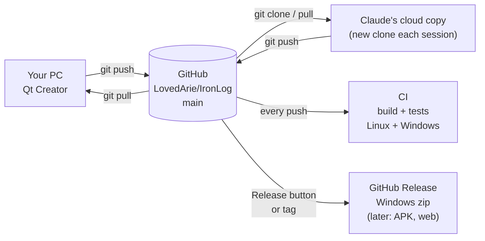

# Developing IronLog

> **What this is:** how we work on the code together, and how to run the app
> on each platform. Releasing has its own page: [RELEASING.md](RELEASING.md).

---

## 1. The loop



**GitHub is the meeting point.** You code on your PC. Claude codes in a
cloud copy that is cloned fresh from GitHub at the start of each session.
Neither of us sees the other's work until it is **pushed**.

| Rule | Why |
|---|---|
| `git pull` before you start | You get Claude's latest work, and Claude's next session gets yours |
| Small commits, push when a step works | Smaller changes = fewer merge conflicts |
| Tell Claude "I pushed" when you did | Claude pulls before touching anything |
| Check the **Actions** tab after a push | CI (build + tests) tells you if something broke |

Both of us push to `main`. If we both changed the **same lines**, `git pull`
stops with a *merge conflict*: git marks both versions in the file, you keep
the right one, then `git add` + `git commit`. Different files or different
lines merge on their own.

---

## 2. First time on your PC

```bash
git clone https://github.com/LovedArie/IronLog.git
cd IronLog
```

Then in **Qt Creator**: *File → Open File or Project…* → `CMakeLists.txt` →
pick the **Desktop Qt 6.x MinGW 64-bit** kit → ▶. Details and the command-line
version: [README → Build and run](../README.md#build-and-run).

Daily:

```bash
git pull                      # 1. get the latest
# ... code, build, run the tests ...
git add -A
git commit -m "Log: undo for deleted sets"
git push                      # 2. share it (CI starts)
```

---

## 3. Run it — where each platform stands

The plan is decided in [ADR-011](adr/ADR-011-phone-first.md): one codebase,
three clients. **iPhone uses the web version — there is no native iOS app.**

| Platform | Today (v0.1) | How it ships | When |
|---|---|---|---|
| **Windows desktop** | ✅ runs (Qt Widgets) | zip from the Release button | now |
| **Android phone** | ❌ not yet | APK (Qt for Android, arm64-v8a) — GitHub Release + `/download/` on your VPS | spike **I4**, then v0.2+ |
| **iPhone** | ❌ not yet | web app (Qt for WebAssembly) at `https://ironlog.<domain>/app/` | spike **I4**, then v0.2+ |
| **UI prototype** | ✅ any browser, any phone | `prototypes/ui-prototype/index.html` | now |

### Windows desktop

Qt Creator ▶, or the zip from the latest
[GitHub Release](https://github.com/LovedArie/IronLog/releases) (unzip, run
`IronLog.exe` — no Qt install needed).

### Android (after the I4 spike)

1. **Qt Maintenance Tool** → add the **Android** component for your Qt version.
2. **Qt Creator** → *Preferences → Devices → Android* → **Set Up SDK**. It
   downloads the Android SDK, NDK and build tools. Qt 6.11 needs **JDK 21+**
   and **NDK 27.2.12479018** (Qt 6.8 used JDK 17).
3. Phone: *Settings → About → tap Build number 7×* → *Developer options →
   USB debugging* on. Plug it in.
4. Pick the **Android Qt 6.x arm64-v8a** kit → ▶. Qt Creator builds the APK
   and installs it on the phone.

### iPhone (after the I4 spike)

No Mac needed. A native iOS build would need a Mac with Xcode and an Apple
developer account, which is why ADR-011 chose the browser route.
The web build is served by Caddy from your VPS, on the same address as the
API. On the iPhone: open the address in Safari → *Share → Add to Home Screen*.

The I4 spike writes the exact WebAssembly build steps (Qt's WebAssembly kit
needs one specific Emscripten version per Qt release).

### UI prototype

Open `prototypes/ui-prototype/index.html` in a browser. To try it on your
phone, see [its README](../prototypes/ui-prototype/README.md).

---

## 4. `build/` and `dist/`

| Folder | Made by | What's in it | In git? |
|---|---|---|---|
| `build/` | CMake / Qt Creator | compiled objects, `IronLog.exe`, test programs | no (`.gitignore`) |
| `dist/` | the **Release** workflow (on GitHub's machine) | `IronLog.exe` + Qt DLLs from `windeployqt` → zipped | no (`.gitignore`) |

You never need `dist/` on your PC. The Release button builds, packages,
smoke-tests and publishes the zip for you ([RELEASING.md](RELEASING.md)).

---

## 5. Windows installer (Inno Setup)?

**Not now.** The zip is enough: the phone is the main client, and Windows
users are you and maybe your partner. An installer adds a Start-menu entry
and an uninstaller — nice, not needed.

If it's ever wanted: one `installer/ironlog.iss` script, plus one step in
`release.yml` after `windeployqt` (GitHub's Windows runners already have Inno
Setup). Parked in [BACKLOG → Later](BACKLOG.md#later-parked--not-counted-in-the-cap).
