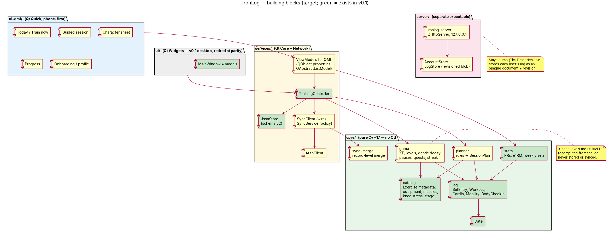
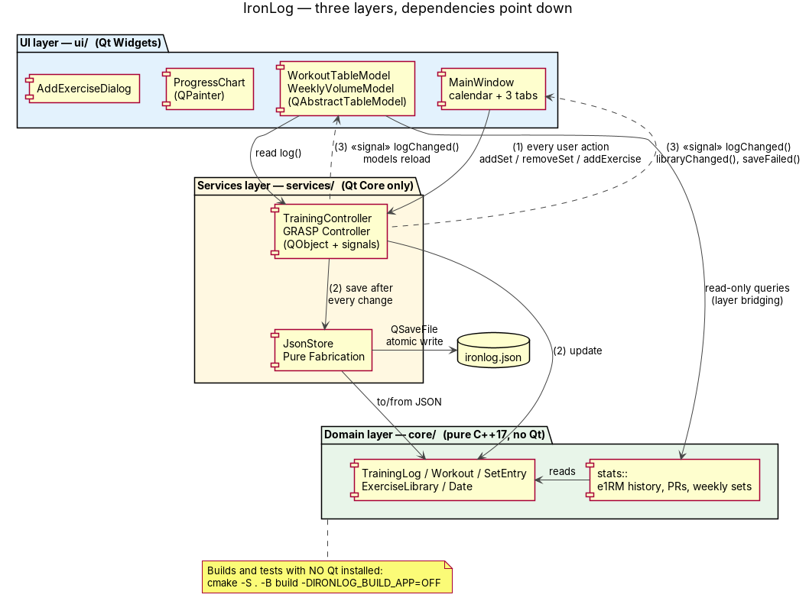
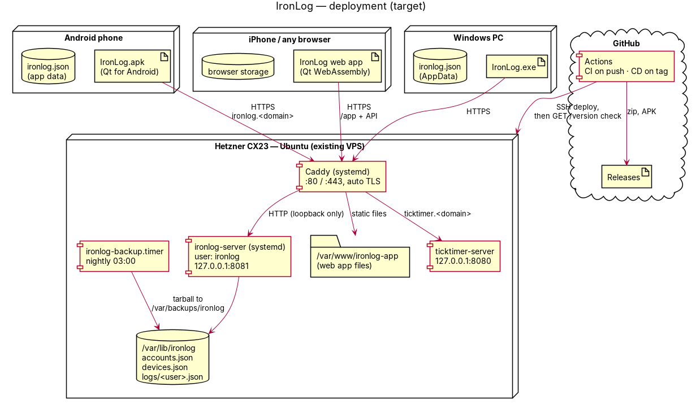
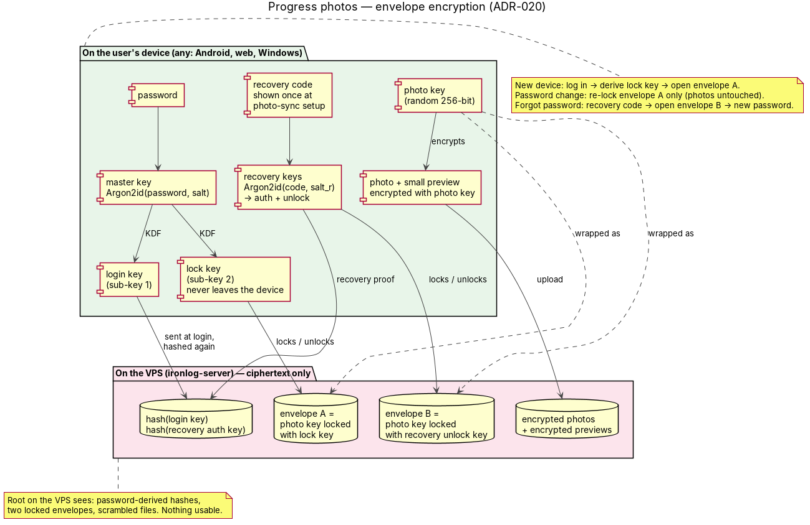

# IronLog — Architecture (arc42)

> **What this is**: the single architecture document for IronLog, in the
> [arc42](https://arc42.org) template's 12 sections. It replaces
> `09_DesignNotes.md` (v0.1), now archived at
> [archive/design-notes-v0.1.md](archive/design-notes-v0.1.md) for the
> detailed v0.1 reasoning. It describes the **target** architecture (v1)
> and marks what **exists today** (v0.1.0) with ✅.
>
> **How to read it**: sections 1, 3, 4 and 5 give the big picture in ten
> minutes. Sections 8 and 9 hold the reasoning. Diagrams live in
> `diagrams/` (PlantUML) with PNGs in `diagrams/rendered/`.

| # | Section | Answers |
|---|---|---|
| 1 | [Introduction and goals](#1-introduction-and-goals) | What must it do, and what quality matters most? |
| 2 | [Constraints](#2-constraints) | What can't we choose? |
| 3 | [Context and scope](#3-context-and-scope) | Who and what does it talk to? |
| 4 | [Solution strategy](#4-solution-strategy) | The few big ideas |
| 5 | [Building block view](#5-building-block-view) | The parts and their jobs |
| 6 | [Runtime view](#6-runtime-view) | Key scenarios step by step |
| 7 | [Deployment view](#7-deployment-view) | Where it runs; CI/CD |
| 8 | [Crosscutting concepts](#8-crosscutting-concepts) | Rules that apply everywhere |
| 9 | [Architecture decisions](#9-architecture-decisions) | ADR log |
| 10 | [Quality requirements](#10-quality-requirements) | Testable quality scenarios |
| 11 | [Risks and technical debt](#11-risks-and-technical-debt) | What could hurt |
| 12 | [Glossary](#12-glossary) | Words |

---

## 1. Introduction and goals

### 1.1 Requirements overview

IronLog is a **phone-first training coach that plays like an MMO**. Full
vision: [01_Vision.md](01_Vision.md). Use cases: [02_UseCaseModel.md](02_UseCaseModel.md).

| Module | Core capability | Status |
|---|---|---|
| Log | Strength sets, cardio, badminton, stretching; edit + undo | ✅ sets only |
| Progress | PRs, e1RM chart, weekly sets per muscle, body check-ins, progress photos | ✅ first three |
| Coach | Goal programs, *Train now* planner, guided session | planned |
| Game | 8 skills, XP, gentle decay, pauses, weekly quest, rest token + own reward, weekly streak, unlocks | planned |
| Online | Accounts, sync via the owner's VPS | planned |
| Platforms | Android, web (WASM), Windows from one codebase | ✅ Windows/Linux desktop |

### 1.2 Quality goals (top 5, in priority order)

| # | Quality | Why it matters here | Scenario |
|---|---|---|---|
| QG1 | **Safety of advice** | The app tells people with injuries what to lift. | Q4 |
| QG2 | **Data durability** | Months of training history must survive crashes, phone loss and sync conflicts. | Q3, Q8 |
| QG3 | **Speed of use** | "Too many taps per set" is the #1 complaint about other apps (research). | Q1, Q2 |
| QG4 | **Fair, explainable game rules** | A game that punishes exam weeks or can't explain its numbers kills motivation. | Q5 |
| QG5 | **Maintainability / testability** | One student developer; portfolio code that can be read and changed. | Q7 |

### 1.3 Stakeholders

| Who | Expects |
|---|---|
| Owner (student, badminton) | Plans that fit his day and body; motivation; works offline |
| Partner | Simple onboarding, own private data |
| Developer (owner) | Clean layers, tests, docs; skills for a C++/AI career |
| Future readers (recruiters) | A codebase that shows good engineering judgment |

---

## 2. Constraints

| Type | Constraint | Consequence |
|---|---|---|
| Technical | C++17, Qt 6 (dev: 6.11, MinGW on Windows), CMake ≥ 3.20 | One language from server to phone |
| Technical | Targets: Android, WebAssembly (iPhone via browser), Windows | Phone-first UI; no native iOS app |
| Technical | Existing **Hetzner CX23** VPS (Ubuntu, x86_64), **Caddy**, **systemd**, no Docker, shared with TickTimer | New app = subdomain + loopback port + systemd unit + Caddy block (TickTimer `ROLLOUT.md` §2i) |
| Organizational | One developer, student schedule | Small iterations; risk-driven order |
| Organizational | Public GitHub repo | No personal health data or secrets in the repo |
| Conventions | UP artifacts (Larman), arc42, TickTimer-style backlog and troubleshooting log | See `08_DevelopmentCase.md` |

---

## 3. Context and scope

### Business context

| Partner | In | Out |
|---|---|---|
| Owner, Partner | Time, situation, equipment, logged sets, check-ins | Session plans, levels, rewards, progress |
| GitHub | Code pushes, version tags | CI results, release files (zip, APK) |

### Technical context

| Channel | Protocol | Notes |
|---|---|---|
| App ↔ Caddy | HTTPS (TLS by Caddy, Let's Encrypt) | `ironlog.<domain>`; JSON API + `/app` web files |
| Caddy ↔ ironlog-server | HTTP on 127.0.0.1:8081 | Never reachable from outside |
| GitHub Actions → VPS | SSH (deploy key in GitHub secrets) | CD only; followed by a `/version` check |

---

## 4. Solution strategy

| Goal / problem | Approach | Section |
|---|---|---|
| Phone + web + desktop from one codebase | **Qt Quick (QML) UI** over the existing C++ layers | ADR-012 |
| Safe, explainable plans | **Rule-based planner** as a pure C++ function; rules come from the owner's written training decisions | 8.5, ADR-013 |
| Fair game that can be rebalanced | **XP and levels are derived** from the log, never stored | 8.6, ADR-014 |
| Works offline, syncs safely | **Local-first** + TickTimer's revisioned-document protocol + **record-level merge** on the client | 8.3, ADR-015 |
| Reuse a proven server setup | Same VPS pattern as TickTimer; **QHttpServer** bound to loopback behind Caddy | 7, ADR-016 |
| Testability | Layers `core → services → ui`; every rule a pure function with "now" passed in | 5, 8.12 |

---

## 5. Building block view

### 5.1 Level 1 — the layers (target)

| Block | Tech | Responsibility | Status |
|---|---|---|---|
| `core/` | Pure C++17 | All training knowledge: log, catalog, stats, planner, game, sync merge | ✅ log, catalog, stats |
| `services/` | Qt Core + Network | Controller (every write), JSON store, sync, auth, view models | ✅ controller, store |
| `ui-qml/` | Qt Quick | Phone-first screens: tabs **Today · Log · Progress · You** (ADR-023); Train now wizard, guided session + mini bar, "How was it?", Why? sheet | planned |
| `ui/` | Qt Widgets | v0.1 desktop UI; retired when QML reaches parity | ✅ |
| `server/` | Qt Core + HttpServer | Accounts, sessions, revisioned log storage | planned |

**Rule**: dependencies point down only (`ui → services → core`). The server
reuses `core/` only for validation, never the UI. (Larman Ch. 13 Layers;
*Software Architecture in Practice* Ch. 8: the allowed-to-use relation must
be one-way.)

### 5.2 Level 2 — `core/` modules

| Module | Main types | Job | Status |
|---|---|---|---|
| `log` | `SetEntry`, `Workout`, `TrainingLog` → v2: `CardioEntry`, `MobilityEntry`, `BodyCheckIn`, `PausePeriod`, `RestTokenUse`, `UserReward` | What happened | ✅ sets |
| `catalog` | `Exercise`, `ExerciseLibrary`, `MuscleGroup` → v2: equipment, secondary muscles, movement pattern, knee stress, stage | What exists | ✅ basic |
| `stats` | free functions | PRs, e1RM history, weekly sets, last set | ✅ |
| `planner` | `Profile`, `TrainContext`, `SessionPlan`, `buildSession()` | What to do today | planned |
| `game` | `SkillSheet`, `xpFor()`, `applyDecay()`, `weeklyQuest()` | Levels and rewards | planned |
| `sync` | `merge(local, remote)` | Combine two copies of a log | planned |
| `Date` | value type | Calendar math | ✅ |

### 5.3 Level 2 — v0.1 classes (as built)

| Class | Layer | Responsibility | Pattern / reason |
|---|---|---|---|
| `Date` | core | Calendar math, ISO text | `struct`: plain value (Stroustrup §16.2.4) |
| `ExerciseLibrary` | core | Unique, trimmed exercise names | Information Expert |
| `SetEntry` | core | One set; volume and e1RM | Invariant via private ctor + `make()` (Stroustrup §17.6.3.2) |
| `Workout` | core | One day's sets; total volume | Information Expert (Larman's `Sale.getTotal()`) |
| `TrainingLog` | core | Sorted workouts; get-or-create | Creator |
| `stats::` | core | Analysis | Free functions keep `TrainingLog` cohesive |
| `JsonStore` | services | Save/load JSON atomically | Pure Fabrication (Larman Ch. 25) |
| `TrainingController` | services | Every write → validate, save, signal | GRASP Controller (Larman Ch. 17) |
| `WorkoutTableModel`, `WeeklyVolumeModel` | ui | Table views | Qt model/view |
| `ProgressChart` | ui | e1RM line chart | Custom `paintEvent()` |

---

## 6. Runtime view

### R1 — *Train now* (cramming night)

1. Three answers: time, situation, equipment (pre-filled from last time).
2. `planner::buildSession()` — pure function — filters the catalog, fits the
   time budget, orders compound-first, sets loads, attaches a "why" to each item.
3. `game::previewXp()` shows what the session is worth.
4. *Start* opens the guided session; every logged set takes the UC-01 path.

### R2 — Log a set (exists)

See `diagrams/sequence_add_set.puml`: controller validates → updates log →
saves atomically → emits `logChanged()` → all views reload.

### R3 — Sync after training offline

1. App marks the log *dirty* on every change (rides `logChanged()`, as TickTimer).
2. When online: `PUT /log` with `baseRevision`.
3. **No conflict** → server stores, returns new revision.
4. **409 conflict** → `GET /log`, `sync::merge(local, remote)` by record id
   (pure function), `PUT` again with the server's revision.
5. Only if a record was **edited differently on both sides** does the user
   choose (rare: sets are mostly appended).

### R4 — Opening the app on a new day

Nothing is "ticked" or stored. The character sheet is recomputed:
`game::computeSheet(log, pauses, today)` applies XP, decay and the comeback
bonus up to today. Same inputs → same levels on every device.

---

## 7. Deployment view

### 7.1 On the VPS (same pattern as TickTimer)

| Item | Value |
|---|---|
| Hostname | `ironlog.<domain>` (A record → VPS IP; DNS on Cloudflare) |
| Caddy | New site block: API → `reverse_proxy 127.0.0.1:8081`; `/app*` → web files; `/download/*` → APK |
| Service | `/etc/systemd/system/ironlog.service`, user `ironlog`, `--bind 127.0.0.1 --port 8081 --data /var/lib/ironlog --invite …`, systemd hardening as TickTimer's unit |
| Data | `/var/lib/ironlog/{accounts.json, devices.json, logs/<user>.json}` — all writes via `QSaveFile` |
| Backups | `ironlog-backup.timer` nightly 03:00 → `/var/backups/ironlog`, 30 days; off-box copy manual for now |
| Firewall | `ufw` allow 22, 80, 443 only (open item on the shared box, also TickTimer's) |

### 7.2 Clients

| Platform | Artifact | Distribution |
|---|---|---|
| Android | Signed APK (Qt for Android, arm64-v8a) | GitHub Release + `https://ironlog.<domain>/download/` |
| iPhone / browsers | Qt WebAssembly bundle | `https://ironlog.<domain>/app/` (same origin as the API → no CORS) |
| Windows | `windeployqt` zip | GitHub Release |

### 7.3 CI/CD (GitHub Actions)

| Pipeline | Trigger | Steps |
|---|---|---|
| **CI** | every push and pull request | (1) Linux, core only, no Qt: build + `test_core` — fast feedback. (2) Linux + Qt: full build, `ctest` with `QT_QPA_PLATFORM=offscreen`. (3) Windows + Qt MinGW: full build + tests. |
| **CD** | tag `vX.Y.Z` | Build Windows zip, Android APK (keystore from secrets), web bundle → GitHub Release. Deploy server + web files to the VPS over SSH → restart service → **`GET https://ironlog.<domain>/version` must return X.Y.Z**, else the job fails. |

The last step answers TickTimer's reason for *not* automating deploys
(`design-addendum-deployment.md` §H: "the value is in the verification").
Here the verification is part of the pipeline.

---

## 8. Crosscutting concepts

### 8.1 Domain model v2 (schema v2)

| Record | Key fields | Notes |
|---|---|---|
| `StrengthSet` | `id`, `at` (date+time), `exerciseId`, `weight`, `unit`, `reps`, `rir?`, `type` (working / warm-up / drop / failure), `note?` | Weight kept **as entered** with its unit |
| `CardioEntry` | `id`, `at`, `kind` (treadmill / walk / run / bike / badminton), `minutes`, `speed?`, `incline?`, `zone?` | Feeds Stamina |
| `MobilityEntry` | `id`, `at`, `routineId`, `minutes` | Feeds Mobility |
| `BodyCheckIn` | `id`, `date`, `bodyweight`, `unit`, `waist?` | "Lean" trend |
| `ProgressPhoto` | `id`, `date`, `pose` (front / side / back), `fileRef`, `previewRef`, `checkInId?` | Image + preview stored beside the JSON, encrypted (§8.14) |
| `SessionReview` | `id`, `date`, `overall` (great / good / ok / rough), `energy` (high / normal / low), `joints` (fine / twinge / pain), `note?`, `prefilled` (which answers the app suggested) | Planner input; `joints = pain` → pain check |
| `GameModeChange` | `id`, `at`, `on` (true / false) | The off-intervals pause decay; the current value is the last record |
| `TimedSet` | as `StrengthSet` but `seconds` instead of `reps` (plank, wall sit, balance) | Same PR/XP rules on duration |
| `PausePeriod` | `id`, `start`, `end`, `reason` (exams / sick / injured / travel) | Stops decay; changes the quest (§8.6); length capped per reason |
| `RestTokenUse` | `id`, `week` | A rest token spent to keep a missed week in the streak |
| `UserReward` | `id`, `text`, `since` | The reward the user writes for completing a weekly quest (free text, optional) |
| `Profile` | goal program, units, equipment sets per place, constraints (knee stage …), weekly availability | Per user |
| `Exercise` | stable `id` slug, name, primary + secondary muscles, equipment set, movement pattern, knee stress (low/med/high), stage, default rep range | Catalog |

Every record also carries `updatedAt` and `deleted` (tombstone) for sync.
**v2 drops "one session per day"**: activities are records with a time.

### 8.2 Persistence and schema versions

- One JSON document per user; `schemaVersion` 2. Strict about the file,
  tolerant about items (v0.1 rule kept).
- **Migration v1 → v2** on first load: generate ids, name → exercise id,
  unit = kg. The v1 file is kept as `ironlog.v1.json` (copy, never move).
- Writes are atomic (`QSaveFile`); unreadable files are moved aside.
- Rotating local backups: last 7 daily copies.

### 8.3 Sync and conflicts

- **Wire protocol = TickTimer's**: `GET /log` → `{revision, data}`;
  `PUT /log` with `baseRevision` → new revision or **409**. The server stores
  an opaque blob and never parses training data.
- **Merge = new for IronLog**: on 409 the client merges by record `id`:
  union of records; same id → newer `updatedAt` wins; tombstones win over
  older edits. `sync::merge()` is a pure core function with exhaustive tests.
- **Why not TickTimer's "a human chooses"**: a training log is append-mostly,
  so most conflicts are two devices adding *different* sets. Union is
  correct for those; asking would be noise.
- Client lessons pre-paid (TickTimer TROUBLESHOOTING): normalize the server
  URL where it's born; branch on HTTP status, not `reply->error()`;
  `clearConnectionCache()` per request.

### 8.4 Derived state

XP, levels, decay, quest progress and **earned** tokens are computed from
the log on demand. Only *inputs* are stored (sets, cardio, pauses,
rest-token uses, the user's reward text). Consequences: nothing to sync or corrupt; rebalancing the
game is a code change that re-scores history; two devices always agree.

### 8.5 Planner (rules engine)

`planner::buildSession(profile, context, history, catalog, today) → SessionPlan`

| Rule | What it does | Source |
|---|---|---|
| P1 Session type | Pick what the weekly plan still needs (strength A/B alternation, zone-2 cardio, mobility); avoid hitting a skill hard < 48 h apart | Owner's plan: A/B full-body ×3 |
| P2 Time budget | Warm-up 5–8 min (RAMP) + main + 3–5 min stretch; ~3 min per strength set incl. rest; drop isolation first, never the warm-up | Owner's plan: RAMP, 60–90 s rest |
| P3 Exercise choice | Equipment ⊆ available; knee stress ≤ current knee stage; compound before isolation | Decision report: pain rule, compound-first |
| P4 Loads | Double progression: all sets at top of rep range → next available weight (e.g. +5 lb dumbbell) | Owner's plan: "picking weights" |
| P5 Situation | **Cramming**: shorter, compound-only, no PR attempts, weekly target = exam minimum (2 strength + 1–2 cardio). **Sore/tired**: mobility + easy zone 2 + light core | Decision report C8 |
| P6 Gates | Harder variations unlock only after their gate (e.g. reverse lunge after 3–4 pain-free weeks of step-ups; stability stage after 2 clean weeks) | Decision report D3, D7 |
| P7 Pain check | "Sharp pain, pinching, or swelling next day" → that exercise drops one stage for 2 weeks | Owner's plan: pain rule |

Each plan item carries a **reason string** ("Box squat: knee-friendly depth,
compound first"). Goal programs (Badminton singles, Lean & toned upper,
Lean & toned lower, General) are **data files**, not code.

### 8.6 Game rules (balance table v1 — tunable, one file)

| Rule | v1 value |
|---|---|
| Skills | Arms, Shoulders, Chest, Back, Core, Legs, Stamina, Mobility |
| XP: strength set | +10 primary skill, +5 each secondary (half-set rule) |
| XP: PR | +25 primary skill |
| XP: cardio / badminton | +2 / min zone 2; +3 / min intervals or badminton |
| XP: mobility | +2 / min |
| Level curve | level L → L+1 costs 50 × L XP (fast early, slower later) |
| Total level | sum of skill levels |
| Progress display | "N sets to next level" on every skill (competence feedback) |
| Decay | after **14 days** with no XP in a skill: **−0.5 %** of that skill's XP per day |
| Decay warning | 3 days before decay starts: "Back starts fading in 3 days"; the body map greys that muscle |
| Floor | decay never goes below 50 % of the skill's peak XP |
| Comeback bonus | XP ×2 while below peak (retraining is faster than first training) |
| Pause | stops all decay. Reasons and caps: exams ≤ 21 days · sick ≤ 14 · injured ≤ 42 · travel ≤ 21 |
| Weekly quest | the program's planned sessions; during a pause: exams → 2 strength + 1 cardio · travel → 1 session · sick / injured → no quest |
| Rest token | quest complete → +1 rest token (bank max 2); spent automatically to keep a missed week in the streak |
| Your reward | optional text the user writes ("movie night"); shown when the quest completes. The app never suggests food and never says "cheat" |
| Streak | consecutive **weeks** with the quest done; rest days count; paused weeks and rest-token weeks keep it; a set logged later for a past day can restore that week; no shaming messages |
| Rules version | the balance table has a version number; when it changes, the app says "Game rules updated — levels recalculated" |

*Game rules v2 (2026-11-23), changed after research round 2
(`research/feature-research-2.md`): decay was gentler than v1 (strength
barely changes in 3 weeks off), cheat-meal token replaced (cheat meals are
linked to eating-disorder symptoms in young adults; "cheat" wording breeds
guilt), streak made weekly and forgiving (Duolingo freezes, Apple pause,
Gentler Streak).*

**Game mode (on/off, per user — ADR-021).** One checkbox, asked at
onboarding and changeable in settings.

| | Game ON | Game OFF |
|---|---|---|
| XP | earned and shown | still computed from the log, not shown |
| Decay | applies after the grace period | **paused** (like a Pause) |
| Levels, body map colours, streak, tokens | shown | hidden |
| Weekly quest | "quest", earns a rest token + shows your reward | plain "2 of 3 planned sessions done" |
| Progression gates, pain check, plans | active | **active** — safety rules never depend on the game |
| Turning back on | — | levels include everything trained while off; nothing lost |

Possible only because game state is derived (ADR-014): the toggle is a
view choice plus a decay pause, not data to migrate.

### 8.7 Units

Weights are stored **as entered** (`weight` + `unit`). Analysis converts to
kg with the exact factor 0.45359237. Display uses the user's unit.
Equipment (e.g. 5–25 lb dumbbells) is defined in its own unit, so load
suggestions are always weights that physically exist.

### 8.8 Security

- HTTPS only between devices and Caddy; the server binds 127.0.0.1.
  Qt's docs say Qt HTTP Server should not be exposed to the internet —
  Caddy is the only thing that talks to it.
- Invite code on `/register`. **Unlike TickTimer, the password never
  reaches the server**: the client derives a *login key* from it (§8.14)
  and the server stores a salted, stretched hash of that key. Session
  tokens in memory; device tokens stored hashed; login brake in the server
  (stock Caddy has no rate limiting).
- Each user can only read and write their own log.

### 8.9 Safety (health)

The planner never generates something outside the user's constraints (P3,
P6, P7 are tested). Onboarding asks about injuries and sets conservative
stages. Every plan screen shows "General guidance, not medical advice;
stop on sharp pain." Personal plans and reports are **not** in the repo.

### 8.10 Error handling

Expected bad input → `std::optional` or a result enum (no exceptions).
Server errors use distinct codes (`auth`, `forbidden`, `conflict`,
`no_such_user`, unknown → "unexpected reply"), as TickTimer learned.

### 8.11 Testing

| Level | Tool | Examples |
|---|---|---|
| Core rules | Catch2 | planner never breaks constraints; decay stopped during every pause reason; merge is commutative for appends |
| Services | Catch2 + Qt Core | store migration v1→v2; controller signals; sync state machine |
| Server | Catch2 + live process | register/login/409 against a real `ironlog-server` on a temp port |
| UI | manual QA checklist + screenshots | phone layout, web build loads |

### 8.12 Time

No core function reads the clock. `today` / `now` is a parameter
(TickTimer lesson: a test that failed only after 5 PM).

### 8.15 "How was it?" — pre-picked answers

`review::suggest(session, plan, history) → SessionReview` is a pure core
function; the UI shows its picks highlighted and the user confirms or taps
another chip.

| Answer | Pre-picked when |
|---|---|
| Overall | ≥ 90 % of planned sets hit target → *Good*; any PR → *Great*; < 60 % → *Rough*; else *OK* |
| Energy | an exams pause or *Cramming* → *Low*; otherwise last review's value |
| Joints | always *Fine* — **never** pre-pick pain; the user must tap it |

The app stores which answers were suggested (`prefilled`), so later
analysis can tell "confirmed" from "chosen". Voice notes use the phone
keyboard's dictation: no speech code in v1.

### 8.14 Progress photos (privacy) — envelope encryption

Body photos are the most sensitive data IronLog holds. Design approved by
the owner 2026-11-23 (ADR-020).

**The keys** (libsodium, the library EyesOff already uses):

| Key | Made from | Lives | Job |
|---|---|---|---|
| Master key | `crypto_pwhash` (Argon2id) of the password + a per-user salt | memory only | Parent of the two sub-keys |
| Login key | `crypto_kdf` sub-key 1 of the master key | sent at login; server stores only a hash of it | Proves who you are — **the server never sees the password** |
| Lock key | `crypto_kdf` sub-key 2 of the master key | **never leaves the device** | Locks/unlocks envelope A |
| Photo key | random 256-bit, made once | inside the envelopes; in memory while unlocked | Encrypts every photo and preview |
| Recovery code | random, shown **once** when photo sync is turned on (e.g. `K7QF-2MZD-…`) | the user's password manager or paper | Backup way in |
| Recovery keys | Argon2id of the recovery code → auth + unlock sub-keys | memory only | Auth proves the code to the server; unlock opens envelope B |

**What the server stores** (all useless without the password or the code):
hash of the login key · hash of the recovery auth key · envelope A (photo
key locked with the lock key) · envelope B (photo key locked with the
recovery unlock key) · encrypted photos and encrypted previews.

**Flows**

| Situation | What happens |
|---|---|
| New device (Android, web, Windows) | Log in → derive lock key → download envelope A → open it → photos decrypt on the device |
| Change password | New master key → new login key + **re-lock envelope A only**; one request; no photo is re-uploaded |
| Forgot password | Enter recovery code → server checks the recovery auth key → open envelope B → choose a new password → new envelope A |
| Lost password **and** code | Server photos can't be opened by anyone. Photos still on a logged-in device are fine (and can be re-uploaded under a new key) |

**Other rules**

| Rule | How |
|---|---|
| Encryption | Photos: `crypto_secretstream_xchacha20poly1305` (built for large files). Envelopes: `crypto_secretbox` |
| Previews | The server can't make thumbnails, so the device makes a small preview, encrypts it, and uploads it next to the photo — galleries load fast everywhere |
| Synced separately | `PUT/GET /photos/<id>` and `/photos/<id>/preview` as opaque blobs; the log only references photo ids |
| Login salt | `GET /prelogin?user=` returns the salt + Argon2id settings needed before login; unknown users get a stable fake salt so the endpoint doesn't reveal who has an account |
| Web app (iPhone) | Browser storage may be cleared, so decrypted photos are a cache, downloaded again when needed; the password is asked again when opening photos in a new browser session |
| Never exported or committed | Not in CSV export, never in the repo |
| Per user | The partner has her own photo key; the owner, as server admin, cannot read her photos |

**Open for F16:** the training log could be locked with the same machinery
(the server would then store an encrypted log blob). Decide when building sync.

### 8.13 Training rules already in v0.1 ✅

| Rule | Definition | Where |
|---|---|---|
| Set volume | weight × reps | `SetEntry::volume()` |
| e1RM (Epley) | weight × (1 + reps/30); 1 rep → weight | `epleyOneRepMax()` |
| PR | first set with the day's top e1RM, **strictly** greater than every earlier day; first-ever session is not a PR | `stats::personalRecordIndices()` |
| Week | Monday–Sunday containing the chosen day | `Date::mondayOfWeek()` |
| Weekly sets | sets per primary muscle in the week; unknown exercises skipped | `stats::weeklySets()` |
| Volume status | < low → Below; > high → Above; default 10–20 | `stats::classify()` |

**About the 10–20 default.** A 2017 meta-analysis (Schoenfeld et al.) found
better hypertrophy above ~9 weekly sets per muscle; a 2022 systematic
review (Baz-Valle et al., *J Hum Kinet* 81:199–210,
https://pubmed.ncbi.nlm.nih.gov/35291645/) suggests 12–20. It's a starting
point and a parameter (`stats::VolumeTarget`); goal programs (F6) will set
their own per-muscle targets.

### 8.16 Exercise pictures

Every exercise shows two pictures (ADR-025): a **how-to picture** (the
IronLog anime character, start pose → end pose) and a **muscle diagram**
(main muscles red, helpers orange). Both are images made with ChatGPT and
checked by eye; the code-drawn alternative (ADR-024) was rejected.

| Piece | Where | What it does |
|---|---|---|
| Image files | `assets/exercises/ironlog-<id>-how.jpg`, `…-muscles.jpg` | 1200 × 800 JPEG, ~80–130 KB each |
| `exercises.json` | `assets/exercises/` | Exercise id → files + main/helper muscles; read with the catalog (F2) |
| Qt resource file | `ui-qml/` (planned) | Bundles the images into the app, so they work offline |
| Clip per exercise | built with ffmpeg (planned) | Switches between start and end pose at the exercise's tempo, then the muscle diagram |
| `CREDITS.md` | `assets/exercises/` | Tool, date, prompts, checks — how to make more that match |

Rules: the muscle names are always shown as text too (never colour alone);
a missing diagram falls back to the text legend (plank, dead bug today).

---

## 9. Architecture decisions

Each decision has its own record in [`docs/adr/`](adr/README.md) — context,
decision, consequences, alternatives, sources. This table is the summary.
Older, longer reasoning for ADR-001 to 009 is also in
[archive/design-notes-v0.1.md](archive/design-notes-v0.1.md) §4.

| # | Decision | Status | Date |
|---|---|---|---|
| [001](adr/ADR-001-three-layers.md) | Three layers as three CMake targets | Accepted | 2026-11-23 |
| [002](adr/ADR-002-own-date-type.md) | Own `Date` type in core instead of `QDate` | Accepted | 2026-11-23 |
| [003](adr/ADR-003-setentry-invariant.md) | `SetEntry` invariant via private constructor + `std::optional` factory | Accepted | 2026-11-23 |
| [004](adr/ADR-004-stats-free-functions.md) | Analysis as free functions (`stats::`) | Accepted | 2026-11-23 |
| [005](adr/ADR-005-jsonstore-pure-fabrication.md) | Persistence as a Pure Fabrication (`JsonStore`) | Accepted | 2026-11-23 |
| [006](adr/ADR-006-single-controller.md) | All writes through one `TrainingController` + signals | Accepted | 2026-11-23 |
| [007](adr/ADR-007-atomic-save.md) | Atomic saves; never overwrite an unreadable file | Accepted | 2026-11-23 |
| [008](adr/ADR-008-hand-painted-chart.md) | Hand-painted chart (no QtCharts) | Accepted | 2026-11-23 |
| [009](adr/ADR-009-app-name-only.md) | Set only the application name (no organization name) | Accepted | 2026-11-23 |
| [010](adr/ADR-010-schema-v2-one-migration.md) | Schema v2 in one migration | Accepted | 2026-11-23 |
| [011](adr/ADR-011-phone-first.md) | Phone-first: Android, web (WASM) and Windows | Accepted | 2026-11-23 |
| [012](adr/ADR-012-qml-ui.md) | Qt Quick (QML) for the new UI | Proposed | 2026-11-23 |
| [013](adr/ADR-013-rule-based-planner.md) | Rule-based planner; AI later on top | Accepted | 2026-11-23 |
| [014](adr/ADR-014-derived-game-state.md) | Game state derived from the log | Accepted | 2026-11-23 |
| [015](adr/ADR-015-record-level-merge.md) | Record-level merge on top of TickTimer's revisioned protocol | Accepted | 2026-11-23 |
| [016](adr/ADR-016-qhttpserver-behind-caddy.md) | QHttpServer behind Caddy on loopback | Proposed | 2026-11-23 |
| [017](adr/ADR-017-systemd-no-docker.md) | systemd, no Docker, on the existing VPS | Accepted | 2026-11-23 |
| [018](adr/ADR-018-risk-driven-order.md) | Risk-driven milestone order | Accepted | 2026-11-23 |
| [019](adr/ADR-019-personal-docs-out-of-repo.md) | Personal training documents stay out of the public repo | Accepted | 2026-11-23 |
| [020](adr/ADR-020-photo-envelope-encryption.md) | Progress photos: envelope encryption | Accepted | 2026-11-23 |
| [021](adr/ADR-021-optional-game.md) | Game layer is optional per user | Accepted | 2026-11-23 |
| [022](adr/ADR-022-game-rules-v2.md) | Game rules v2 (evidence-based) | Accepted | 2026-11-23 |
| [023](adr/ADR-023-four-tab-navigation.md) | Four-tab navigation (Today · Log · Progress · You) | Accepted | 2026-11-23 |
| [024](adr/ADR-024-exercise-pictures-drawn-by-code.md) | Exercise pictures drawn by code (form animation + muscle map) | Rejected | 2026-11-23 |
| [025](adr/ADR-025-exercise-pictures-from-chatgpt.md) | Exercise pictures generated with ChatGPT (anime character + muscle diagram) | Accepted | 2026-11-23 |

**Proposed** decisions are waiting for evidence: ADR-012 (QML) on the I4
spike, ADR-016 (QHttpServer) on F15.

---

## 10. Quality requirements

| # | Scenario | Measure | Test |
|---|---|---|---|
| Q1 | Owner logs a repeat set mid-workout | ≤ 3 taps or 1 key combo | QA checklist |
| Q2 | *Train now* on a phone, offline | Plan shown < 1 s after the last answer | Timed in QA |
| Q3 | App killed while saving | Previous file intact | ✅ `test_services` |
| Q4 | Planner with knee stage 1 and any input | Never returns a knee-stress-high exercise | Property test over many contexts |
| Q5 | 21 days without training during an exams pause | No decay; streak kept | Catch2 |
| Q6 | Port 8081 probed from the internet | Times out | `curl` from mobile data |
| Q7 | Core built on a machine without Qt | Builds and passes | ✅ CI job 1 |
| Q8 | Same day logged on phone and PC offline, then both sync | All sets present once | Catch2 on `sync::merge` + live test |
| Q10 | Game off for 60 days of training, then on again | Levels reflect all training; no decay applied for the off period | Catch2 on `game::computeSheet` |
| Q9 | Someone with root on the VPS opens the photo store | Sees only ciphertext | Inspect `/var/lib/ironlog/photos/` in QA |
| Q11 | User forgets the password, has the recovery code | All photos back on every device; none re-uploaded | Live test: reset via code, open on a 2nd client |

---

## 11. Risks and technical debt

Full register: [05_RiskList.md](05_RiskList.md). Top risks:

| Risk | Mitigation |
|---|---|
| Generated plans cause injury | Rules from written decisions, gates, pain check, tests (Q4) |
| QML + Android + WASM is new territory | Spike first (backlog I4) |
| Sync merge loses data | Ids, tombstones, pure merge with tests, server backups |
| Gamification backfires (decay feels like punishment) | Game rules v2: 14-day grace, warning, pauses, comeback bonus, floor, weekly streak, game can be turned off |
| Scope is large for one student | Milestones, backlog cap, risk-driven order |

**Technical debt (known)**

- Exercise referenced by **name** (fixed by schema v2 ids).
- Widgets UI will be duplicated by QML until retired.
- Full model resets in table models (fine at current sizes).
- No CI yet (backlog I2).

---

## 12. Glossary

See [04_Glossary.md](04_Glossary.md).

---

## Sources

- arc42 template: https://arc42.org
- Larman, *Applying UML and Patterns* (3rd ed.): Ch. 8 (risk-driven
  iterations), Ch. 13 (Layers), Ch. 17 (Expert, Creator, Controller),
  Ch. 25 (Pure Fabrication).
- Bass, Clements, Kazman, *Software Architecture in Practice* (4th ed.), Ch. 8 §8.4 (Layers).
- Stroustrup, *The C++ Programming Language* (4th ed.), §16.2.4, §17.6.3.2.
- TickTimer repo (owner's): `docs/ROLLOUT.md` §2, §2i; `docs/design-addendum-sync.md`;
  `docs/design-addendum-deployment.md` §H; `docs/SERVER.md`; `deploy/`.
- Owner's *Fitness Plan* and *Physical Decision Report* (2026-11-09) — rule
  sources for §8.5. Kept privately, not in the repo.
- Feature research: [research/feature-research.md](research/feature-research.md).
- Qt HTTP Server limitations: https://doc.qt.io/qt-6/qthttpserver-index.html
