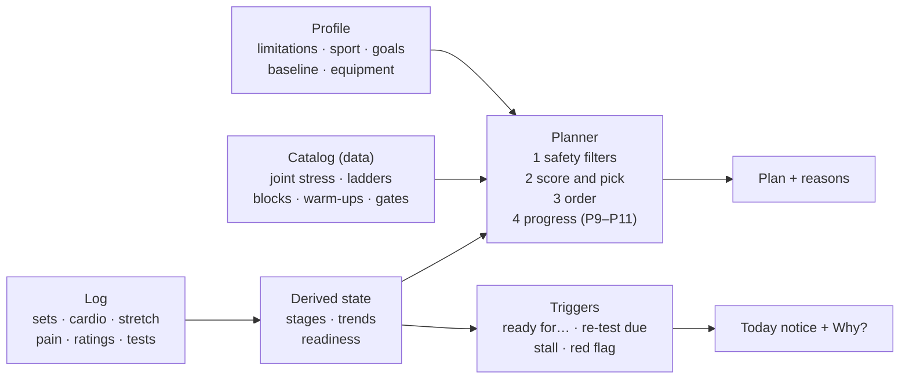

# From one plan to features for everyone

> **What this is**: the problems the owner's fitness plan and Decision
> Report solve for **one person**, turned into features that work for
> **any user**. **Read it when** you plan v0.3 (Coach) or v0.6 (Coach+), or
> wonder why the app asks about joints, sports or baselines.

**Sources read in full (2026-11-23):** the owner's fitness plan (43 pages)
and Decision Report (17 pages). Both stay private (ADR-019). This doc keeps
only the general problems, not the owner's health details.

**Method, per problem:**

1. **Seen:** what the plan does about it, for one person.
2. **Scaled:** who else has the same problem.
3. **Feature:** what the app does, driven by data, so a new joint, sport or
   goal is a new **row in a table**, not new code.

---

## 1. Overview

| # | Seen in the plan | Scaled to everyone | Feature | Backlog |
|---|---|---|---|---|
| 1 | One joint needs care (the example: a knee) | Any joint, either side: knee, shoulder, lower back, ankle, hip, wrist, neck | **Body limitations**: joint + stage; every exercise rates its stress per joint; the planner filters and swaps | **F25** (new) |
| 2 | Pain rule: sharp pain, pinching, swelling next day → back off | Anyone who trains through aches | **Pain monitoring**: 0–10 during, plus a next-morning check; red flags → see a professional | F25, F10 |
| 3 | Long break, so start easy | Anyone back from injury, illness, exams, a new baby | **Return ramp**: lower volume at first, up a step a week | F5, F7 (P9) |
| 4 | Stiff, slow to recover | Many users, at any age | Longer holds for tight spots (done, F24); recovery days from the profile | F24, F5 |
| 5 | Low cardio starting point | Everyone starts somewhere different | **Cardio program**: talk-test baseline, weekly table, one change at a time, intervals after a base | **F27** (new) |
| 6 | Home dumbbells stop at 25 lb | Anyone whose heaviest weight is too light | **Past your heaviest weight**: more reps, slower lowering, a pause, then a one-leg or one-arm version | F7 (P11) |
| 7 | No coach checks form | Every solo user | **Form safety**: first-time how-to, simple exercises first, cues that depend on your limitations ("pad your knee") | F7, F23 |
| 8 | Training must not hurt badminton | Any sport | **Sport profile**: sport days, no hard legs within 24 h before, sport warm-up, accessories for the sport | **F28** (new) |
| 9 | Exams come and go | Any busy period | Pause + exam-week minimum | Done (F13) |
| 10 | Goals with no test (last a whole game; reach behind the back; explosive first step) | Every goal needs a number | **Goal tests every 4 weeks** (time before gassed, reach test, balance, reps) | **F26** (new) |
| 11 | "Revisit when…" (jogging later; upper/lower split later; phase-2 checklist; stage gates) | Every plan decision has conditions | **Gates and triggers**: the app watches the log and says "ready for…", with the reason | **F26** (new) |
| 12 | Knee-care and stability blocks, 2–3× a week, in stages | Any joint or sport needs prehab | **Prehab blocks** with a weekly target, picked from limitations and sport | **F28** (new) |
| 13 | Decision criteria with weights; safety always wins | Every plan choice | Planner picks exercises by **score**, after safety filters (K1–K6) | F7 |

Parts already covered elsewhere: the daily stretch (F24), exercise pictures
(F23), the weekly body check-in (F18), the session review (F10).

---

## 2. Feature details

### F25 Body limitations *(the knee, scaled)*

**Seen.** The plan treats one knee carefully. Depth is controlled with a box.
Lunges wait for pain-free weeks of step-ups. Kneeling moves get a pad or a
swap. There's a weekly "knee feeling 1–10".

**Scaled.** Many users have one joint that needs care. The rules have the
same shape for every joint. Only the data changes.

| Piece | How it works |
|---|---|
| Limitation | User picks a joint, a side and a starting stage. Notes stay on the device |
| Joint stress | Each exercise rates stress per joint: low / medium / high. It also flags kneeling, impact, deep bend and overhead |
| Stage ladder | Per joint, data: which stress level each stage allows, and which exercises unlock at each stage |
| Filter | Planner rule P3: stress ≤ what the stage allows, for **every** limitation. The safety filter runs first and nothing can override it |
| Swap and cues | Kneeling + knee limitation → "pad your knee" cue, or the standing version. Overhead + shoulder limitation → a neutral-grip version |
| Weekly rating | 0–10 per limitation in the body check-in. Feeds the gates (F26) |

**Pain monitoring.** It replaces the yes/no pain check. The scale is 0–10,
during the exercise and the next morning:

| Pain | What the app does |
|---|---|
| 0–3 during, settled next morning | OK, keep going |
| 4–5, or still there next morning | Keep the load the same; don't progress |
| > 5, or worse next morning | That exercise drops a stage for 2 weeks |

This is the pain-monitoring model from tendon rehab (Silbernagel et al.
2007). There, loading up to 5/10 was allowed if it settled by the next day.
IronLog uses a stricter 3/10 for "OK", because no clinician is involved.

**Red flags.** These stop the exercise and point to a professional:
swelling, heat or redness, locking, giving way, or not being able to take
weight. The app never diagnoses (NHS, healthdirect).

**Readiness screen.** Onboarding links the PAR-Q+, a validated free
questionnaire, rather than copying it. If any answer is yes, the app
suggests checking with a doctor or a qualified exercise professional first.
The app still works, with conservative stages.

**Scene.** A user marks *right shoulder, stage 1*. Train now drops the
overhead press and gives a neutral-grip dumbbell press at medium stress. The Why? sheet says: "Shoulder stage 1 allows medium overhead
stress."

### F26 Gates, goal tests and triggers *(the "revisit when", scaled)*

**Seen.** The plan is full of conditions:

- move up a stage after 2 clean weeks;
- reverse lunges after 3–4 pain-free weeks of step-ups;
- a phase-2 readiness checklist at week 8;
- jogging once a 40-minute walk is easy and 8 pain-free weeks have passed;
- an upper/lower split after 3–4 months;
- a re-test every 4 weeks.

**Scaled.** Every plan decision comes with "do X when Y". One mechanism
covers them all.

| Piece | How it works |
|---|---|
| Gate | Criteria + minimum time: "2 weeks, all sessions done, joint rating ≤ 2". Uses both **time and criteria**: rehab research says time alone doesn't show readiness |
| Trigger | A condition over derived stats, plus a message and an offer: "You've walked 40 min at 7 % for 2 weeks with no knee pain. Try light jogging?" Never automatic; you tap to accept |
| Goal test | A scheduled measurement: time before gassed in your sport, the reach test, single-leg balance, reps of a test exercise. Due every 4 weeks; charted in Progress |
| Review | Week 8 and month 3–4: the app offers the next phase or a split change |
| Stall → deload | Was F22. Now one trigger in the same engine |

Gates and triggers are **data files**, like goal programs. A physio-written
program could ship its own gates.

### F27 Cardio program *(the low baseline, scaled)*

**Seen.** A week-by-week treadmill table (time, speed, incline). The plan
says to change only one of them at a time. Intervals arrive in week 5.
Don't hold the rails.

**Scaled.** Every user starts somewhere different.

- **Baseline:** a 10-minute talk test. Raise the speed until you can talk
  but not sing. Research ties the talk test closely to the ventilatory
  threshold, so no heart-rate strap is needed.
- **Table built from the baseline:** the plan's shape, +5 min every 2 weeks,
  then speed, then incline. **One change at a time** (rule P10).
- **Intervals** unlock after 4 weeks of base (a gate, F26).
- **Jogging** is a trigger (F26), shown only if no limitation forbids
  impact.

### F28 Sport profile and prehab blocks *(badminton, scaled)*

**Seen.** Badminton days are fixed. Static stretching comes after play.
The badminton warm-up differs from the gym one. Add-on stretches and
accessories target what badminton loads. Knee care and stability blocks
come 2–3 times a week.

**Scaled.** Any sport: running, soccer, basketball, climbing.

| Piece | How it works |
|---|---|
| Sport profile | Data: body areas it loads, a RAMP warm-up, its "weak spots" (badminton: wrists, inner thighs, back of the shoulder, knee control) |
| Sport days | Planner rule: no hard legs within 24 h before a sport day; the sport session counts toward Stamina |
| Warm-up | Generated from the sport's RAMP template before play. No static holds (P8) |
| Prehab block | 10–12 min, from limitations + sport (McGill Big 3, balance, step-downs…). Has stages and a weekly target (e.g. 3×) |

### In the planner (F7) — rules P9 to P11

| Rule | What it does | Seen in the plan |
|---|---|---|
| P9 Return ramp | After a long break, or a pause over 3 weeks: week 1 at about 60 % of normal sets, +10 % a week (tunable defaults in the balance table, not research numbers) | "Detrained: tendons adapt slower" |
| P10 One change at a time | Progress one of weight / reps / sets (strength) or time / speed / incline (cardio) per step | Treadmill tips |
| P11 Past the heaviest weight | At the top weight and top reps: slower lowering (3 s), then a pause, then a one-leg or one-arm version | Home rack tops out at 25 lb |

The **choice** step (P3) scores candidates on the report's criteria:
safety, effectiveness, sustainability, equipment, sport transfer, time. It
runs only after the hard filters. Safety is a filter, never a weight to
trade off.

---

## 3. How it fits together

**Why this scales in code:** the knee is one row in each table: the
ladder, the joint-stress columns, the prehab blocks. A shoulder is one more
row. New code is only needed when a new **kind** of rule appears.
Everything stays derived from the log (ADR-014), so it's testable as pure
functions with "today" passed in.

---

## 4. Safety boundaries

| The app does | The app does not |
|---|---|
| Uses self-reported limitations and conservative starting stages | Diagnose, treat or name injuries |
| Lowers load or swaps exercises on pain | Push through pain or reward it |
| Stops on red flags and points to a professional | Say a joint is "fine" |
| Links the PAR-Q+ at onboarding | Copy it, or store the answers on the server |
| Says "general guidance, not medical advice" on every plan | Replace a physio's program (but it can **import** one as data later) |

New risk **R-24** (risk list): someone follows the plan with a condition
the rules don't fit.

---

## 5. Sources

- Silbernagel KG et al. (2007), pain-monitoring model, *Am J Sports Med*
  35(6):897–906: https://search.pedro.org.au/search-results/record-detail/18389
  · 5/10 limit, settled next day:
  https://blogs.bmj.com/bjsm/wp-json/wp/v2/posts/6921
- PAR-Q+ Collaboration, *The Physical Activity Readiness Questionnaire for
  Everyone* (2020 version): https://doi.org/10.14288%2Fhfjc.v12i4.295
- Knee red flags: NHS https://www.nhs.uk/symptoms/knee-pain/ · healthdirect
  https://www.healthdirect.gov.au/amp/article/knee-pain
- Criteria- vs time-based progression: review (2022)
  https://pmc.ncbi.nlm.nih.gov/articles/PMC8811519/ · Dingenen & Gokeler
  (2017) https://pubmed.ncbi.nlm.nih.gov/28078610/
- Talk test and ventilatory threshold: https://pubmed.ncbi.nlm.nih.gov/21774751/
  · used to regulate intensity: https://pubmed.ncbi.nlm.nih.gov/25536539/
- Muscle adapts faster than tendon: Lambrianides et al. (2024), *Scand J Med
  Sci Sports*, https://doi.org/10.1111/sms.14638 · caution after detraining:
  https://pubmed.ncbi.nlm.nih.gov/26973517/
- The owner's fitness plan and Decision Report (private; constraints C1–C8,
  criteria K1–K6, decisions D1–D9).
